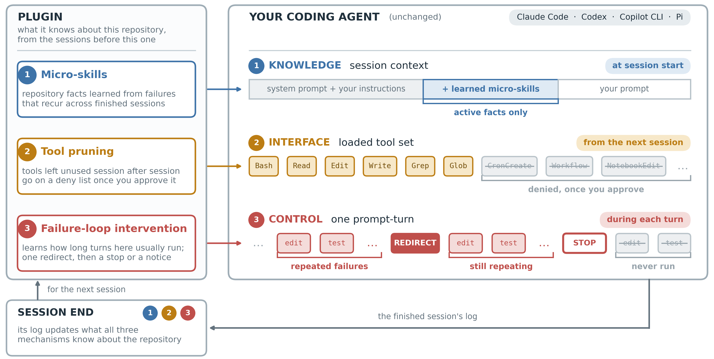

# TokenEconomizer: Experience-Driven Black-Box Cost Control for Coding Agents

<p align="center">
  Aaron J. Li<sup>1</sup>,
  Weijia Xu<sup>2</sup>,
  Chandan Singh<sup>2</sup>,
  Zixiao Chen<sup>3</sup>,
  Jeevana Priya Inala<sup>2</sup>,
  Charlotte Siska<sup>3</sup>,
  <br>
  Acar Tamersoy<sup>3</sup>,
  Bin Yu<sup>1</sup>,
  Ion Stoica<sup>1</sup>,
  Michel Galley<sup>2</sup>,
  Jianfeng Gao<sup>2</sup>
</p>
<p align="center">
  <sup>1</sup>UC Berkeley &nbsp; <sup>2</sup>Microsoft Research &nbsp; <sup>3</sup>Microsoft Security
</p>

<p align="center">
  <a href="https://arxiv.org/abs/XXXX.XXXXX"></a>
  <a href="https://tokeneconomizer.github.io"></a>
  
  
</p>

<p align="center"></p>

TokenEconomizer is a plugin for **Claude Code**, **Codex**, the **GitHub Copilot CLI** and
**Pi**. It leaves the agent as it is, reads each finished session in a repository, and changes
what the next sessions in that repository pay for:

- **Micro-skills.** Environment facts your sessions keep rediscovering by failing at them --
  that `pytest` is missing here and `python -m pytest` works, that the test runner wants labels
  without a `tests.` prefix -- are learned from recurring evidence and stated at the start of
  the next session. Learning them makes no model call.
- **Tool pruning.** Tools that stay loaded but go unused, session after session, are proposed
  as a deny list. Nothing changes until you approve it, and it applies from the next session.
- **Failure-loop intervention.** A turn that keeps repeating the same failing edit-and-test
  cycle, well past how long this repository's turns usually take, gets one redirect, then a
  stop (headless) or a notice.

Each mechanism can be switched off or tuned on its own. The plugin's actions are announced in
one line, every hook fails open, and by default it makes no model calls of its own. What it learns
stays on your machine, under `~/.tokeneconomizer`.

## Supported agents

| Agent | Install |
|---|---|
| Claude Code | `claude plugin marketplace add /path/to/TokenEconomizer`<br>`claude plugin install tokeneconomizer@tokeneconomizer` |
| Codex | `codex plugin marketplace add /path/to/TokenEconomizer`<br>`codex plugin add tokeneconomizer@tokeneconomizer`, then trust its hooks when Codex asks |
| Copilot CLI | `copilot plugin marketplace add /path/to/TokenEconomizer`<br>`copilot plugin install tokeneconomizer@tokeneconomizer` |
| Pi | `pi install git:github.com/microsoft/TokenEconomizer` |

**Any plan or login works.** The plugin runs inside your agent's own sessions and never handles
credentials, so it works with whatever your agent is signed in with: a Claude subscription or an
Anthropic API key for Claude Code, a ChatGPT plan or an OpenAI API key for Codex, a Copilot
subscription or a bring-your-own-key provider for the Copilot CLI, and any provider Pi is set up
with. It needs no API key of its own.

Claude Code, Codex and the Copilot CLI install from a clone of this repository, through their
own plugin commands; Pi installs the package straight from GitHub, as any Pi package does. You
need Python 3.10 or newer on `PATH`, and nothing else. Plugins load when a session starts, so
start a new one. **[`plugin/README.md`](plugin/README.md)** walks through each agent: the first
run, its commands, updating, uninstalling, Copilot with your own model key, and troubleshooting.

## Quick start

```bash
git clone https://github.com/microsoft/TokenEconomizer.git
claude plugin marketplace add ./TokenEconomizer
claude plugin install tokeneconomizer@tokeneconomizer
```

Then, in a new Claude Code session inside one of your repositories:

```text
/tokeneconomizer:toolprune refresh-catalog    # once on this machine: record the tools a session loads
```

Work as usual; the plugin needs nothing from you. To see what it is doing:

| Command | What it shows or does |
|---|---|
| `/tokeneconomizer:status` | what it learned in this repository, what it did, and what your sessions cost |
| `/tokeneconomizer:microskills` | the facts it injects at session start, and those still forming |
| `/tokeneconomizer:toolprune` | the proposed deny list and its evidence; `… apply` accepts it, `… restore` undoes it |
| `/tokeneconomizer:config` | the settings: what is on, and every value in effect |

On Codex, ask for them or name the skill (`$tokeneconomizer-status`, `-microskills`,
`-toolprune`, `-config`); on Pi they are `/te <command>`. On any agent they are also free from a
terminal inside the repository, as `~/.tokeneconomizer/bin/te <command>`.

## Settings

```text
/tokeneconomizer:config set loopguard=off                 # one mechanism off, in this repository
/tokeneconomizer:config set toolprune=off --global        # ... or in every repository
/tokeneconomizer:config set microskills_max_facts=2       # inject at most two facts
/tokeneconomizer:config set toolprune_evidence=10         # wait ten unused sessions before proposing
/tokeneconomizer:config set loopguard_nudges=2            # allow two redirects per turn
/tokeneconomizer:config set loopguard.min_turns=30        # 30 tool calls before a turn can count as stuck
/tokeneconomizer:config unset loopguard.min_turns         # back to the default
```

The paid extras are off unless you set `paid=true`: an LLM proposer that authors repository
facts beyond the free ones (`microskills=envfacts+distiller`) and a stuck judge for the loop
guard, both run through your own agent's CLI, on the same plan or login as your sessions, and
recorded in the session's ledger. Every
setting, its default and its environment variable: [Settings](plugin/README.md#settings).
Settings written under the earlier names (`inject`, `untool`, `spiral`, ...) are still read.

## What it does on each agent

| | Micro-skills | Tool pruning | Loop guard |
|---|---|---|---|
| Claude Code | at session start | tools, in `.claude/settings.local.json` | redirect; can stop a headless turn |
| Codex | at session start | capability packages, in the project's `.codex/config.toml` | redirect, then a notice |
| Copilot CLI | at session start | whole MCP servers, in `.github/copilot/settings.local.json` | redirect, then a notice |
| Pi | at session start | — (Pi loads four tools) | redirect; can stop a headless turn |

Nothing is written to your settings until you approve it, and `toolprune restore` removes only
what the plugin added. How each agent's hooks and settings were verified to behave is in
**[`docs/PLUGIN.md`](docs/PLUGIN.md)**; the method itself is in **[`docs/METHOD.md`](docs/METHOD.md)**.

## Repository

| | |
|---|---|
| [`tokeneconomizer/microskills`](tokeneconomizer/microskills/) | Micro-skill synthesis and injection: facts learned from finished sessions |
| [`tokeneconomizer/toolprune`](tokeneconomizer/toolprune/) | Tool pruning: unused tools and Codex capability packages |
| [`tokeneconomizer/loopguard`](tokeneconomizer/loopguard/) | Failure-loop intervention: the per-call guard and its per-repository envelope |
| [`tokeneconomizer/trace`](tokeneconomizer/trace/) | Each agent's session log, read into one shape |
| [`tokeneconomizer/plugin`](tokeneconomizer/plugin/) | The runtime the hooks and the `te` command run |
| [`plugin`](plugin/) | The installable plugin: manifests, hook files, launchers, slash commands, the Pi extension |
| [`experiments`](experiments/) | The benchmark harness, arms, workloads and run book behind the paper |
| [`docs`](docs/) | `PLUGIN.md` (design, verified agent behavior) and `METHOD.md` (the method) |
| [`tests`](tests/) | Offline tests for the package and the plugin |

The package is standard-library only. Run the tests with `python -m pytest tests` (add
`experiments/tests` for the benchmark side), and build a self-contained plugin bundle with
`python3 scripts/build_plugin.py --out dist/marketplace`.

## Reproducing the experiments

The benchmark experiments -- the Docker harness that runs sealed agents on SWE-bench and
Web-Bench, the arms, the sweep and aggregation pipeline, and the evaluated task sets -- live in
**[`experiments/`](experiments/README.md)**. They are not packaged with the plugin and share
only `tokeneconomizer/`.

## Citation

```bibtex
@article{li2026tokeneconomizer,
  title   = {{TokenEconomizer}: Experience-Driven Black-Box Cost Control for Coding Agents},
  author  = {Li, Aaron J. and Xu, Weijia and Singh, Chandan and Chen, Zixiao and
             Inala, Jeevana Priya and Siska, Charlotte and Tamersoy, Acar and Yu, Bin and
             Stoica, Ion and Galley, Michel and Gao, Jianfeng},
  journal = {arXiv preprint arXiv:XXXX.XXXXX},
  year    = {2026}
}
```

## License

Apache 2.0; see [`LICENSE`](LICENSE).
